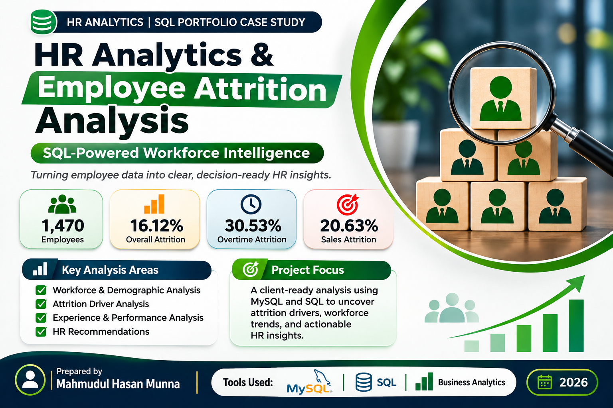
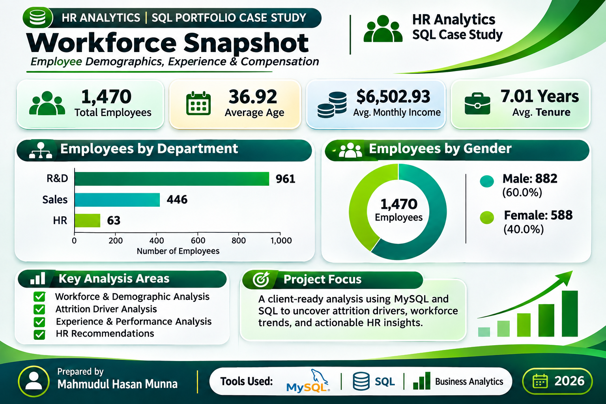
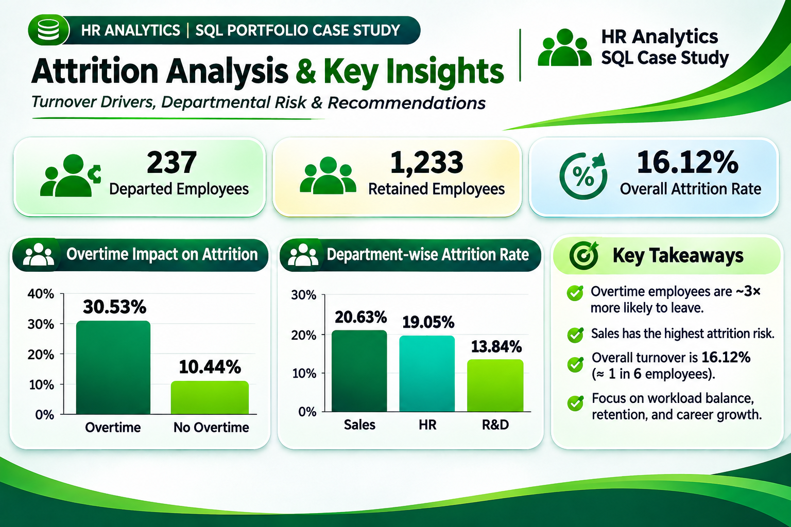

# HR Analytics & Employee Attrition

**SQL workforce analytics · MySQL · Retention-focused reporting**

A portfolio case study examining **1,470 employee records** to describe workforce composition and identify observed attrition differences across departments and overtime groups. The project presents the findings and analytical methods documented in the accompanying report.

[Read the full case study](reports/HR_Analytics_Case_Study.pdf) · [Workforce snapshot](assets/workforce-snapshot.png) · [Attrition findings](assets/attrition-insights.png)

## Business questions

- What does the workforce look like across departments, demographic groups and experience levels?
- How do observed attrition rates differ between overtime and non-overtime employees?
- Which departments warrant further retention analysis?
- What workforce metrics can support focused HR reporting?

## Project snapshot

| Reported metric | Result |
| --- | ---: |
| Employee records | 1,470 |
| Departures | 237 |
| Retained employees | 1,233 |
| Overall attrition | 16.12% |
| Average age | 36.92 years |
| Average monthly income | $6,502.93 |
| Average tenure | 7.01 years |

## Tools and analytical methods

**MySQL / SQL:** database preparation and validation, aggregation, grouping, filtering, calculated KPIs and `CASE WHEN` segmentation.

The report describes analysis of workforce composition, compensation, experience, performance and satisfaction, followed by department-level KPI comparisons and retention-focused interpretation.

## Selected findings

### Overtime and observed attrition

| Overtime status | Reported attrition rate |
| --- | ---: |
| Overtime | 30.53% |
| No overtime | 10.44% |

The overtime group has approximately **2.9 times the observed attrition rate** of the non-overtime group. This comparison describes an association; role, tenure and other workforce characteristics may explain part of the difference.

### Department comparisons

| Department | Employee count | Reported attrition rate |
| --- | ---: | ---: |
| Research & Development | 961 | 13.84% |
| Sales | 446 | 20.63% |
| Human Resources | 63 | 19.05% |

**Sales has the highest reported departmental attrition rate.** This supports prioritizing further investigation rather than treating department membership as a proven cause of departures.

## Analytical workflow

1. Prepare and validate the database fields used for workforce reporting.
2. Summarize employee counts, compensation and experience with SQL aggregations.
3. Segment employees using filters and `CASE WHEN` logic.
4. Compare observed KPIs across departments and overtime groups.
5. Communicate findings, interpretation limits and retention priorities.

## Recommendations

- Review workload and overtime exposure while accounting for role and tenure where possible.
- Prioritize further retention analysis in Sales, supported by exit interviews and manager check-ins.
- Develop mentoring and career pathways for mid-level employees.
- Track engagement, mobility and retention KPIs by department and experience.

## Project gallery

### Workforce snapshot

### Attrition analysis

## Repository contents

| File | Purpose |
| --- | --- |
| [Case study PDF](reports/HR_Analytics_Case_Study.pdf) | Original six-page project report |
| [Project overview](assets/hr-overview.png) | Scope, tools and headline results |
| [Workforce snapshot](assets/workforce-snapshot.png) | Workforce composition and reported averages |
| [Attrition findings](assets/attrition-insights.png) | Overtime and department comparisons |

## Scope and source notes

This repository is a **report-based portfolio case study**. The supplied PDF and three project graphics are preserved without edits. Original SQL scripts, employee-level data, significance tests and a reporting period are not included in the supplied materials. No new database execution or independent raw-data verification is claimed.

The results are descriptive associations. The report does not quantify a direct statistical link between satisfaction, performance ratings and employee departures.

## About the analyst

**Mahmudul Hasan** · Data Analyst · Excel / SQL / SPSS

[LinkedIn](https://www.linkedin.com/in/mahmudulhasan-analyst) · [GitHub](https://github.com/munna-hasan) · [Email](mailto:mmunna.hasan18@gmail.com)
